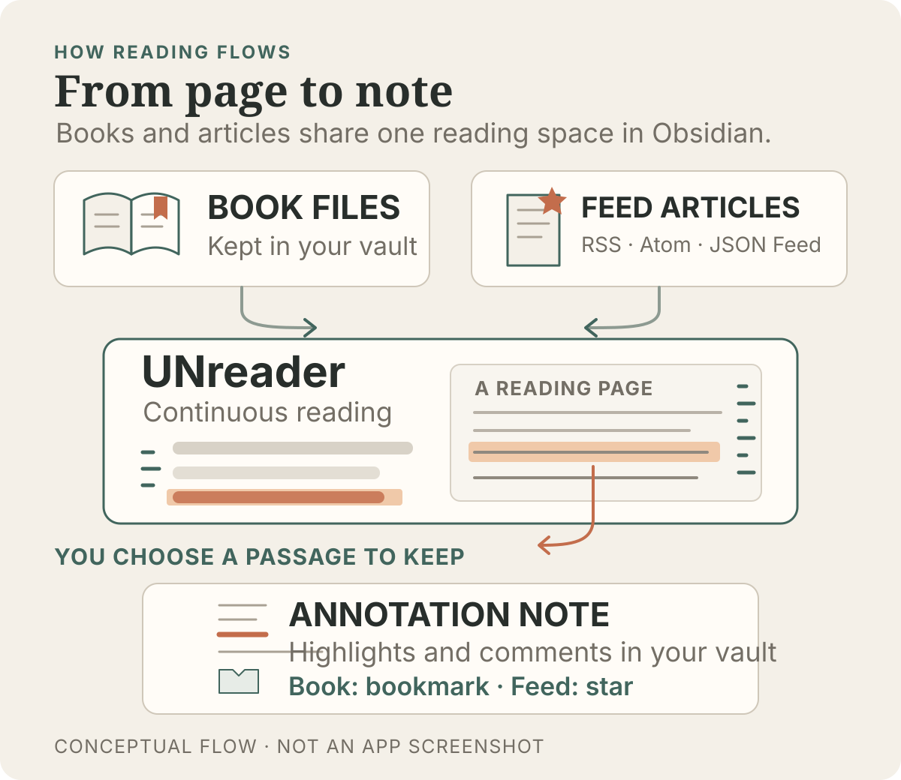

# UNreader

**Read your books inside Obsidian. Pick up where you left off, and keep your highlights and comments close to your notes.**

UNreader is for people who want to read EPUBs and other books alongside the notes they already keep in Obsidian. It brings continuous reading, a table of contents, highlights, bookmarks, and comments into your vault. It also includes RSS/Atom/JSON Feed reading.

<p align="center">
  
</p>

Selected passages and comments are saved as Markdown notes in the vault. Books use bookmarks; feed articles use stars.

[Install from the Obsidian Community directory](https://community.obsidian.md/plugins/unreader) · [Read release notes](https://github.com/UNcore-gh/UNreader/releases) · [Open the public repository](https://github.com/UNcore-gh/UNreader)

Part of the UN series: [UNmemos](https://github.com/UNcore-gh/UNmemos) 记 · **UNreader 读** · [UNagent](https://github.com/UNcore-gh/UNagent) 用.

## Start reading

1. In Obsidian, open **Settings → Community plugins → Browse**, search for **UNreader**, then install and enable it.
2. Add an EPUB, MOBI, AZW3, or TXT file to your vault.
3. Open the Command Palette (`Cmd/Ctrl + P`) and choose **UNreader: Vault: choose and open a book** (or **UNreader: 全库：选择并打开书籍** in Chinese). You can also open a supported book from Obsidian's file list.

The bookshelf and book picker list EPUB, MOBI, AZW3, and TXT files. Local HTML/HTM files can be opened from the file list, but do not appear on the bookshelf. PDF is not supported; Obsidian opens PDFs with its own viewer.

## What you can do

- **Read comfortably:** keep chapters in one continuous scroll, jump from the floating table of contents or chapter rail, and restore your place when you return.
- **Keep your reading notes:** highlight text, add bookmarks and comments, then find them in the annotations sidebar.
- **Make the page yours:** adjust fonts, spacing, margins, colours, backgrounds, and reusable appearance presets.
- **Read feeds too:** subscribe to RSS, Atom, RDF/RSS 1.0, or JSON Feed; import and export OPML; save article snapshots for offline reading; and play or download podcast audio.
- **Use it on desktop or mobile:** UNreader follows Obsidian's reading surface and includes touch-friendly navigation and an immersive reading mode.

## Updates

The [GitHub Releases page](https://github.com/UNcore-gh/UNreader/releases) lists published versions and their changes. Features described above refer to the public release; work that has not shipped is not included here.

## Network and privacy

UNreader does not send telemetry. Reading books and annotations works offline. Feed and podcast features use the network to add or refresh subscriptions, fetch article text, and play or download podcast media. UNreader does not run periodic background feed polling. If enabled in settings, opening the Feeds sidebar can trigger one refresh.

Books, annotations, and cached feed snapshots are stored in your vault. Podcast and image media caches are kept in a local IndexedDB database and are not part of vault sync. UNreader does not bypass paywalls or logins, and video podcasts are not supported.

## Compatibility and license

- Requires Obsidian **1.7.2 or later**.
- The plugin is available on desktop and mobile.
- Source Available License — commercial use requires permission. See [LICENSE](LICENSE).

## Development

This repository contains UNreader's source code. To install dependencies and build the plugin:

```bash
npm install
npm run build
```

For a live development build, use `npm run dev`. Build outputs are generated at the repository root; edit `src/styles.css` for style changes. The public release repository is [UNcore-gh/UNreader](https://github.com/UNcore-gh/UNreader).
